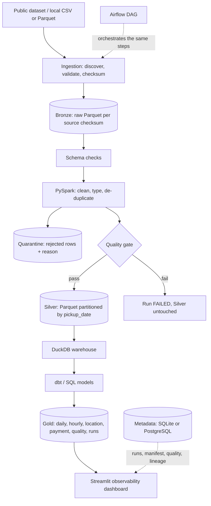

# DataTrust - Local Data Lakehouse & Data Quality Platform

[](https://www.python.org/downloads/)
[](https://spark.apache.org/)
[](https://duckdb.org/)
[](https://www.getdbt.com/)
[](https://streamlit.io/)
[](tests/)
[](https://github.com/astral-sh/ruff)
[](LICENSE)

A production-grade data engineering platform that ingests NYC taxi trip records, builds an automated
**Bronze $\to$ Silver $\to$ Gold** lakehouse on local Parquet, validates data quality through a robust 22-rule
framework with quarantine routing, tracks file-level incremental state and lineage, and provides full pipeline observability in a real-time Streamlit dashboard. Everything runs locally — **no cloud account or external infrastructure required**.

---

### Key Engineering Highlights

- **Medallion Architecture (Bronze $\to$ Silver $\to$ Gold)**: Immutable raw Bronze Parquet, strongly-typed partitioned Silver Parquet, and analytical Gold dimensional models.
- **Incremental State Manifest**: Cryptographic SHA-256 file-level tracking classifies inputs as `NEW`, `UNCHANGED`, `CHANGED`, `RETRY`, or `DUPLICATE_CONTENT`.
- **Pre-Commit Quality Gate & Quarantine**: 22 data quality checks evaluated on staged partitions; dirty rows route to `quarantine/` with failure reasons rather than silent dropping.
- **Atomic, Crash-Safe Partition Swapping**: Journaled two-phase commit protocol ensures Silver data is never corrupted during mid-pipeline interruptions.
- **Embedded Analytics & Lineage**: Fast OLAP aggregations with DuckDB and dbt SQL models, paired with granular file-to-model lineage tracking.
- **Interactive Observability**: Live Streamlit UI featuring freshness alerts, failure trends, partition inspect, and lineage visualization.

---

## Architecture



Details: [ARCHITECTURE.md](ARCHITECTURE.md), [DATA_DICTIONARY.md](DATA_DICTIONARY.md),
[DATA_QUALITY_RULES.md](DATA_QUALITY_RULES.md), [TROUBLESHOOTING.md](TROUBLESHOOTING.md).

## Technology stack

Python 3.11 (3.10-3.12), PySpark 3.5, Parquet (pyarrow), DuckDB, dbt-core + dbt-duckdb,
Apache Airflow 2.9 (Docker only), PostgreSQL (optional metadata store), SQLite (default
metadata store), Pandera, pytest, Ruff, Streamlit, Plotly, Docker Compose, GitHub Actions.
Versions are pinned in `requirements*.txt`; that exact combination has **not** been
resolved/installed by the author yet (no network at generation time) - see Troubleshooting if pip reports a conflict.

## Dataset

Primary dataset: NYC TLC trip records
(<https://www.nyc.gov/site/tlc/about/tlc-trip-record-data.page>). The pipeline never contacts
that website. Download a monthly file yourself (or run `scripts\download_data.ps1`) and point
the pipeline at it, or use the built-in **deterministic synthetic sample** that includes
deliberately bad rows so the quality framework has something to catch.

## Prerequisites (Windows)

- Python 3.11 (python.org), Git, VS Code.
- **Java 17** (Temurin) on `PATH` - PySpark requires it.
- Spark on native Windows usually also needs `HADOOP_HOME\bin\winutils.exe`. If you do not want that,
  run the pipeline in Docker (below). `scripts\setup.ps1` warns about both.
- Docker Desktop (optional; for Postgres/Airflow/containerised runs). Spark needs about 2-4 GB RAM,
  Airflow stack about 6 GB RAM and 8 GB disk.

## Quick start (Windows PowerShell, lightweight mode)

```powershell
git clone https://github.com/Ayyappanmj/DataTrust.git ; cd DataTrust
.\scripts\setup.ps1                       # prerequisites check, .venv, dependencies, .env
.\scripts\generate_sample_data.ps1        # data\sample\yellow_tripdata_2023-0{1,2}_sample.csv
.\scripts\run_pipeline.ps1                # discover -> Bronze -> Silver -> DuckDB -> models -> checks
.\scripts\run_dashboard.ps1               # http://localhost:8501
```

Lightweight mode = SQLite metadata + no Airflow. The CLI is the real interface:

```powershell
.\.venv\Scripts\python -m src.cli --help
.\.venv\Scripts\python -m src.cli ingest --input data/sample      # steps 1-4 only
.\.venv\Scripts\python -m src.cli run --input data/sample
.\.venv\Scripts\python -m src.cli status
.\.venv\Scripts\python -m src.cli lineage --dataset gold.daily_trip_metrics
```

Exit codes: `0` success, `2` completed with failed files (`PARTIAL_FAILURE`), `1` run failed.

### Using real TLC data

```powershell
.\scripts\download_data.ps1 -Month 2023-01      # optional; or download manually into data\raw
.\scripts\run_pipeline.ps1 -InputPath data\raw
```
Parquet and CSV are both supported. One month is ~3 million rows; use `DATATRUST_SPARK_DRIVER_MEMORY=4g`.

## Incremental ingestion

State lives in the **ingestion manifest** (SHA-256 of every file). Each run classifies every file:

| Action | Meaning |
|---|---|
| NEW | never seen - ingest and process |
| UNCHANGED | same checksum already processed - skipped |
| CHANGED | same path, new bytes - new version replaces the old version's rows |
| RETRY | earlier attempt did not finish - resume the missing stage |
| DUPLICATE_CONTENT | same bytes under another file name - skipped and reported |
| FORCE | `--force`: controlled reprocessing of an unchanged file (replaces, never appends) |

```powershell
.\scripts\generate_sample_data.ps1 -Months 2023-03    # adds a file; Jan/Feb bytes are unchanged
.\scripts\run_pipeline.ps1                            # only the new file is processed
.\scripts\run_pipeline.ps1 -Force                     # explicit reprocessing, still no duplicates
```

**File-level vs record-level incremental.** DataTrust is *file-level*: it decides per file, and
de-duplicates records by a business key inside Silver. *Record-level incremental processing* (tracking each
insert/update/delete inside a source system, i.e. change-data-capture) is **not implemented** - TLC files are
monthly snapshots with no change feed.

## Backfills

```powershell
.\scripts\run_backfill.ps1 -Start 2023-01-10 -End 2023-01-12
```
Rebuilds only the partitions in the range from **Bronze** (inclusive dates; whole months when
`DATATRUST_PARTITION_SCHEME=monthly`), runs the quality gate, swaps only those partitions, reloads them into
DuckDB and rebuilds models. Dates are naive taxi wall-clock dates (no timezone conversion).

## Partitioning

Silver is partitioned by `pickup_date` (daily; ~30 folders per month, ~100k rows per partition for real TLC data).
Set `DATATRUST_PARTITION_SCHEME=monthly` for `pickup_month`. Writes go to a staging area, pass the quality gate, then
only affected partitions are swapped with a crash-safe journal. `python -m src.cli benchmark` measures real query
times for unpartitioned / monthly / daily / daily+hourly layouts with DuckDB. **Partitioning helps** when queries filter
on the partition column (fewer files read); it **hurts** when partitions are tiny (many small files, slower
planning/listing) or queries ignore the column. Benchmark results are single-machine and synthetic: they show relative behaviour only.

## Data quality

22 built-in rules plus file-level checks (see [DATA_QUALITY_RULES.md](DATA_QUALITY_RULES.md)). Each rule records dataset, name,
description, evaluated/passed/failed counts, failure %, timestamp, severity (INFO/WARNING/ERROR/CRITICAL) and status
(PASSED/WARN/FAILED). Thresholds and severities are configurable in `config/quality_rules.yaml`. Rejected rows are
never dropped silently: they land in `data/quarantine` with `rejection_reason` and the raw record. Reports:
`data/reports/quality/<run>__<stage>.json` and `.txt`. A CRITICAL failure (default gate) aborts the run **before** Silver is changed.

## dbt

The model SQL in `dbt_project/models` is the single source of truth.

```powershell
.\scripts\run_dbt.ps1 -Command build      # models + schema tests + singular tests (needs a populated warehouse)
$env:DATATRUST_MODELING_ENGINE="dbt"      # make `run` use dbt instead of the built-in SQL renderer
```
Lightweight mode renders the same SQL (`ref()`/`source()`) and runs it in DuckDB; dbt adds tests and docs.
Models are tables, not incremental: they are small aggregates over a table that is replaced partition-by-partition, so a full rebuild
is cheap and always correct.

## Airflow

`dags/datatrust_pipeline.py`: 11 tasks in a linear chain with retries (2, exponential backoff), 45 min execution timeout,
`max_active_runs=1`, configurable schedule (`DATATRUST_SCHEDULE`), failure callback that marks the run FAILED. Tasks call
`python -m src.cli step ...` in a separate virtualenv; only a deterministic run id is shared, nothing goes through XCom.

```powershell
copy .env.example .env   # then replace every placeholder password / generate AIRFLOW_FERNET_KEY
.\scripts\docker.ps1 -Action airflow-init
.\scripts\docker.ps1 -Action airflow     # UI http://localhost:8080
```
Task order: discover_input_files > validate_source_files > ingest_source_data > run_schema_checks > bronze_to_silver >
execute_quality_rules (gate + commit) > load_duckdb > run_dbt_models > final_quality_checks > record_lineage > generate_run_summary.

## PostgreSQL metadata

`DATATRUST_METADATA_BACKEND=postgres` (explicit - there is **no silent fallback**; an unreachable DB raises an error).
`.\scripts\docker.ps1 -Action postgres`, then set the `DATATRUST_PG_*` variables in `.env`. Tables: pipeline_runs,
ingestion_manifest, datasets, quality_results, processing_errors, lineage_edges, backfill_history, partition_metadata.

## Docker (commands run inside containers)

```powershell
.\scripts\docker.ps1 -Action pipeline    # docker compose run --rm app ... (use this if native-Windows Spark is a hassle)
.\scripts\docker.ps1 -Action dashboard   # http://localhost:8501
.\scripts\docker.ps1 -Action down
```

## Testing

```powershell
.\scripts\run_tests.ps1 -Fast     # ruff + tests that need no Spark
.\scripts\run_tests.ps1           # everything (Spark, DuckDB, dbt, dashboard); PostgreSQL tests need DATATRUST_TEST_PG_*
```
Acceptance tests (`tests/integration/test_pipeline_end_to_end.py`) assert against **independently computed expected values**
from the sample generator (not against the pipeline's own output). Core tests need no paid cloud service.

## Verification status

| Component | Status | Details |
|---|---|---|
| **Automated Test Suite** | **117 passed, 0 failed** | Unit, quality rule, schema validation, and incremental logic tests pass with `pytest` |
| **Code Quality & Linting** | **Clean (0 errors)** | Checked and formatted with `ruff check .` |
| **PySpark Ingestion & Transformations** | **Verified & Executed** | Ingests Bronze raw Parquet and outputs strongly-typed Silver Parquet partitioned by `pickup_date` |
| **Data Quality Gate & Quarantine** | **Verified & Executed** | 22 validation rules evaluated; clean records committed, dirty records routed to `data/quarantine` |
| **DuckDB Analytical Warehouse** | **Verified & Executed** | Syncs Silver partitions and runs analytical aggregates with zero cloud overhead |
| **dbt SQL Modeling Engine** | **Verified & Executed** | Renders and builds 8 dimensional/mart models (`daily_trip_metrics`, `hourly_demand_pattern`, etc.) |
| **Streamlit Observability Dashboard** | **Live & Verified** | Live dashboard at `http://localhost:8501` showing health, latency, rule stats, and lineage |
| **Incremental SHA-256 Manifest** | **Verified & Executed** | Correctly skips unchanged files, resumes failed files, and rejects duplicate content |

## Known limitations

- Duplicate key is a business key (vendor, times, locations, passengers, distance, fare, total); TLC has no trip id.
- Rejected duplicates of a file that is later superseded stay in quarantine (documented stale-quarantine edge case).
- The `pipeline_run_summary` model is a snapshot taken when models are built (the run is still RUNNING then); the
  dashboard reads live run data from the metadata store.
- Spark on native Windows may need winutils; Docker avoids it.
- Lineage is dataset-level only (files, checksums, runs, datasets). No column-level lineage.
- Benchmarks are single-machine and synthetic.
- Rules for coordinates only apply when coordinate columns exist (modern TLC files have none).

## Future improvements

Delta/Iceberg table format, Great Expectations adapter, Spark partition-level metrics in benchmarks, taxi-zone dimension,
data-contract checks in CI, alerting on quality gate failures, OpenLineage emission.
